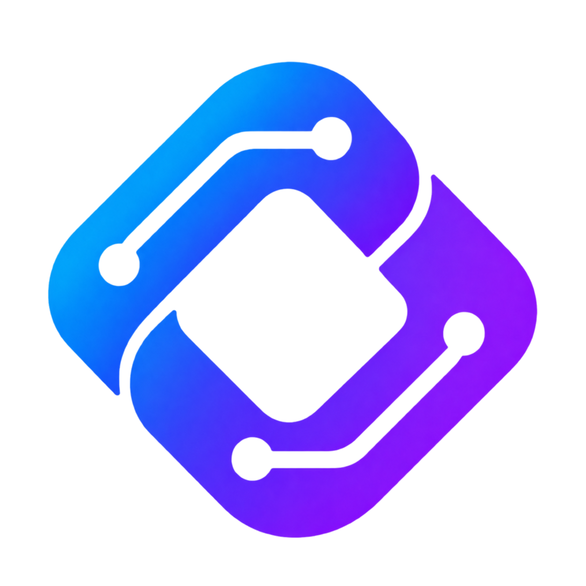

# Alliance Command Center brand artwork

Owner: @asbillings07. Refs #379. On November 3, 2026 the owner selected Alliance Link, approved its circuit styling, requested an application PR, then directed removal of the central A while keeping the rest. The resulting mark has two blue/violet interlocking forms, rounded circuit channels and an open center.

## Source and use

- `app/icon.png` is the retained 1254 × 1254 transparent RGBA PNG master. `app/apple-icon.png` is byte-identical, preserving the artwork for both metadata conventions. Both have SHA-256 `4de8033e5aa5d470d1a69e68e98900d1d327b4bb68de1c456fa16a173941dd15`.
- The master was created with built-in image generation, then edited to remove only the central A. Its prior circuit/A source had SHA-256 `8ae93aa6df96cf54ab5219588c4fb2d4c1b60fcb24024ee3a3a19a47ef7a712f`. This is raster artwork, not a vector or a claim of pixel-identical generative editing.
- On November 11, 2026 the owner approved direct Python pixel cleanup, approved the cleaned image, and requested an application PR. This refinement removes low-opacity stray pixels, smooths edge coverage, and replaces contaminated fringe colors with adjacent original artwork colors. The open center, circuit cutouts, blue/violet gradient, proportions, transparency, and canvas size are retained; solid interior pixels are unchanged. The pre-cleanup master remains in Git history with SHA-256 `7c77c1cb6e6816e6b0f37ef20ac5bd7a51070143990a9ecff12e3a11bd76e19a`.
- `BrandLockup` pairs the master with a two-line Alliance / Command Center wordmark. Public and authentication headers use a 48px image; the authenticated alliance header uses 36px and hides the wordmark below the `sm` breakpoint while retaining the accessible brand-link label. Next.js static imports preserve content-hashed image URLs and appropriately sized derivatives. The artwork itself is unchanged.
- Next.js file-based metadata supplies the browser and Apple touch icon links from the two image files. No manual duplicate metadata or new manifest is added. See the [Next.js icon convention](https://nextjs.org/docs/app/api-reference/file-conventions/metadata/app-icons).
- Keep the transparent background, open center, circuit details, color blend and proportions. Use `object-contain`; do not crop, round the image box, add a shadow/glow, or apply color filters. The small rendition remains a product identifier rather than a status indicator.

## Aptelum reference and local scope

Canonical design reference: [Aptelum design system at `35f2d6e4460b6a16b2a8d9c6fa98aeb298e43dae`](https://github.com/asbillings07/aptelum/blob/35f2d6e4460b6a16b2a8d9c6fa98aeb298e43dae/docs/design-system/README.md). The reference is pinned deliberately; do not fetch or apply a moving branch automatically.

Referenced document SHA-256: `1afc247b9911a9e21bfef9617f0abe911069f346021ae87364b72ade274adb75`.

Alliance Link is this product's own identity. Aptelum's attribution mark remains a separate, supplied asset: company experiences use solid blue, product experiences use the original blend, and developer-only experiences use deep violet. This change does not redraw or substitute for that attribution mark.

The blue/violet product artwork, thin identity rule, workspace heading accent and active platform navigation are identity exceptions to the application's monochrome functional-icon and single-accent UI guidance. Functional actions and form selection stay blue; status colors and charts retain their separate meanings. This reference is not company-policy adoption or a runtime authorization grant.

## Final edit prompt

> Remove ONLY the capital letter A from the center of the circuit-detailed Alliance Link icon, replacing it with transparency. Preserve the linked silhouette, proportions, circuit channels and terminals, blue/indigo/violet palette, transparent background and margin. Do not add new symbols, letters, shadows or framing.

The supplied raster is the source of truth for this revision. Future refinements need owner visual review. Design approval and source updates do not claim final integrated human QA, deployment, or publication.

## Application identity refresh (#383)

Proposed for owner preview review before production adoption. The approved cleaned artwork remains unchanged.

- Use deep navy surfaces, readable cool-white typography, and one consistent lockup across entry points, the alliance shell and Platform Operations. Keep the existing Geist family.
- The welcome page explains people, participation and perspective while keeping Sign In, Redeem Invitation and Request Beta Access available. Mobile puts entry actions before the supporting capability descriptions. Keep the private-beta statement honest.
- Authentication uses the same header and quiet identity rule, with a focused form panel. Supporting copy is shown only where desktop space allows; form fields, error handling, password controls, OAuth availability and destinations are unchanged.
- App pages retain their information hierarchy, dense tables, permissions and workflows. Shared cards use a 12px radius; page gutters reduce at narrow widths. The header remains compact and labels are accessible when the wordmark is hidden.
- Apply the palette throughout invitations, setup, imports, metrics, reports, account settings, guided-help popups and Platform Operations. Components must use shared tokens instead of literal hex colors or numbered Tailwind color shades.
- Violet belongs to identity artwork, the thin blue/violet rule, workspace heading accents and active platform navigation. Navigation uses `brand-surface`, `brand-selection` and readable `brand-text`; it never indicates operational success, warning or failure. Use no glow, patterned starfield, decorative motion, gradients in charts, or invented usage statistics. See the [color tokens](../color-design-principles.md).
- This visual proposal does not authorize a production release. Owner preview QA, review and green CI are required before merge and deployment.
